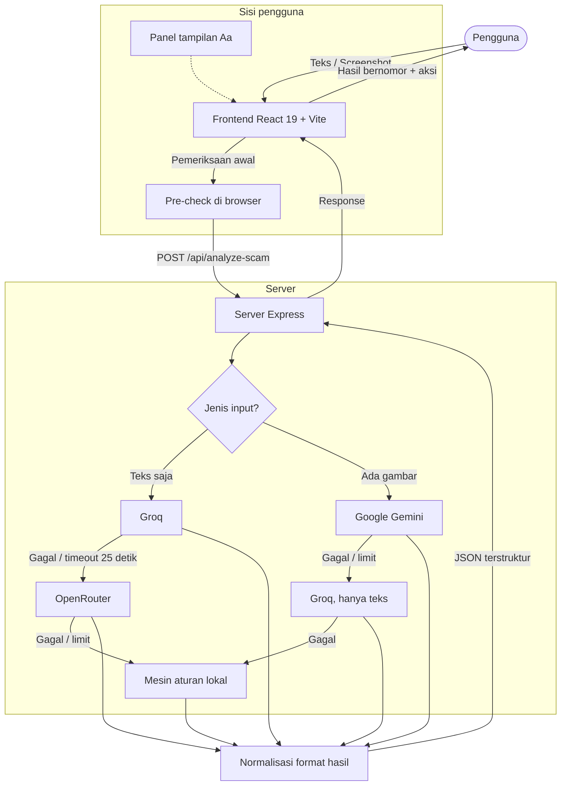

# Cek Dulu

Cek Dulu adalah aplikasi web untuk memeriksa pesan atau tautan yang dicurigai sebagai penipuan sebelum sempat diklik, sekaligus tempat belajar mengenali modus-modus yang sedang beredar di Indonesia. Kami membuatnya untuk LOGICODIX 2026 Hackathon dengan tema *NextGen Digital Innovation: Crafting Creative Solutions for a Better Society*.

## Tentang tim

- **Nama tim:** DOA DARI ARIF WICAK
- **Anggota:**
  1. Muhammad Rafli – (Fullstack Developer & AI Integration / 2507411089 / Politeknik Negeri Jakarta)
  2. Rizka Cahya Meilani Putri – (Frontend Developer & UI/UX Designer / 2507411017 / Politeknik Negeri Jakarta)
  3. Dhani Wira Saputra – (Content Researcher / 2507411020 / Politeknik Negeri Jakarta)
  4. Arif Wicaksono – (Fullstack Developer / 2507411019 / Politeknik Negeri Jakarta)
- **Kategori:** Aplikasi web (MVP)
- **Subtema:** Civic Tech & Community Service, dengan sentuhan Smart & Fun Education
- **Target pengguna:** masyarakat umum, keluarga, lansia, pelaku UMKM, dan siapa pun yang pernah atau hampir menjadi korban penipuan siber

## Latar belakang

Penipuan lewat pesan, tautan, dan aplikasi palsu terus memakan korban di Indonesia. Modusnya macam-macam: berkas APK yang menyamar jadi foto kurir atau surat tilang, bank palsu yang mengabarkan tarif naik, lowongan kerja "like video", sampai pinjol ilegal yang meneror kontak korban. Yang paling sering kena biasanya orang yang panik atau tergiur hadiah, terutama orang awam dan lansia.

Edukasi yang ada umumnya berupa artikel atau poster. Isinya benar, tetapi korban jarang membukanya tepat pada saat menerima pesan mencurigakan. Yang dibutuhkan adalah tempat untuk mengecek pesan itu saat itu juga, tanpa ribet.

Dari situ kami membuat Cek Dulu. Pengguna tidak perlu mendaftar atau login, cukup buka, tempel pesan, lalu lihat hasilnya. Kami juga menyediakan pengaturan tampilan untuk lansia: teks besar, kontras tinggi, dan pembacaan hasil dengan suara.

## Fitur

### Periksa pesan

Pengguna bisa menempel teks chat atau SMS, atau mengunggah tangkapan layar. Hasilnya berupa tingkat risiko (aman, waspada, atau bahaya), daftar alasan, dan langkah yang sebaiknya dilakukan, semuanya bernomor supaya mudah diikuti.

Beberapa hal yang bisa dilakukan dari hasil pemeriksaan:

- Menyalin ringkasan peringatan untuk dikirim ke grup keluarga.
- Menyalin draf laporan yang sudah berisi kronologi dan kanal pengaduan resmi (OJK 157, cekrekening.id, patrolisiber.id). Kode OTP di dalam pesan otomatis disamarkan menjadi `••••`.
- Mendengarkan hasil pemeriksaan lewat suara.

Kalau layanan AI sedang bermasalah, aplikasi tetap memberi jawaban lewat mesin aturan lokal (lihat bagian arsitektur).

### Simulasi kasus

Simulasi percakapan interaktif. Pengguna membaca pesan dari "penipu", memilih respons, lalu melihat apa akibatnya dan mengapa pilihan itu berbahaya atau aman. Ada enam skenario:

1. Berkas `.APK` dari "kurir paket"
2. "Customer service bank" yang mengabarkan kenaikan tarif transaksi
3. Teror dan penagihan pinjol ilegal
4. Penipuan asmara dan investasi
5. Rekening bersama (rekber) atau kasir marketplace palsu
6. Hadiah undian palsu yang mengatasnamakan BUMN

### Kuis edukasi

14 soal berbasis kasus, terbagi dalam tiga tingkat: Pemula, Menengah, dan Mahir. Setiap jawaban disertai penjelasan, baik yang benar maupun yang salah. Poin XP tersimpan di browser pengguna.

### Ensiklopedia modus

Kumpulan modus penipuan beserta cara kerjanya, tanda-tandanya, cara melindungi diri, dan apa yang harus dilakukan kalau sudah terlanjur menjadi korban. Detailnya dibuka di jendela dialog yang bisa dinavigasi dengan keyboard.

### Cek tautan

Alamat tautan dipecah supaya terlihat siapa pemilik domainnya yang sebenarnya. Aplikasi lalu menandai hal-hal yang janggal: akhiran domain yang sering dipakai situs tiruan (`.xyz`, `.top`, `.icu`, `.buzz`), tautan yang dipendekkan, subdomain yang menyamar, dan alamat tanpa HTTPS.

### Langkah darurat

Tombol "Kena tipu? Lihat langkah darurat" ada di bagian atas setiap halaman. Isinya langkah-langkah untuk 30 menit pertama setelah tertipu (memblokir m-banking, mencoba menahan transfer, mengamankan akun) dan daftar kontak bank serta lembaga yang bisa dihubungi.

### Pengaturan tampilan

Tombol "Aa Tampilan" melayang di pojok kanan bawah dan tersedia di semua halaman. Isinya:

- Ukuran teks: Normal, Besar (115%), dan Sangat besar (130%).
- Mode kontras tinggi.
- Pembacaan hasil dengan suara berbahasa Indonesia, memakai Web Speech API bawaan browser.

## Arsitektur

Aplikasi terdiri dari frontend React dan server Express yang menjadi perantara ke penyedia AI. Server itu juga yang menyimpan API key, jadi kunci tidak pernah sampai ke browser.



Urutan penyedia AI yang dipakai:

| Jenis input | Pertama | Cadangan | Terakhir |
|---|---|---|---|
| Teks saja | Groq (`qwen/qwen3.8-27b`) | OpenRouter (`liquid/lfm-2.5-2.6b:free`) | Mesin aturan lokal |
| Gambar + teks | Gemini (`gemini-2.5-flash`) | Groq, hanya membaca bagian teks | Mesin aturan lokal |
| Gambar saja | Gemini (`gemini-2.5-flash`) | Pengguna diminta menempel teks dari gambar | Panduan tempel teks manual |

Mesin aturan lokal bekerja dengan pencocokan kata kunci dan pola, misalnya berkas `.apk`, permintaan OTP atau PIN, janji hadiah, dan batas waktu yang menekan. Hasilnya tidak sedalam analisis AI, tetapi pengguna tetap mendapat jawaban saat internet atau layanan AI bermasalah.

## Teknologi

- **Frontend:** React 19, TypeScript 5.8+, Tailwind CSS v4, Motion untuk animasi, Lucide React untuk ikon
- **Build:** Vite 8 dengan `vite-plugin-singlefile`, sehingga hasil build berupa satu berkas `dist/index.html`
- **Backend:** Node.js, Express, `tsx`
- **AI:** Google Gemini lewat `@google/genai`, Groq dan OpenRouter lewat REST API
- **Suara:** Web Speech API (`SpeechSynthesis`)

## Etika dan keamanan digital

**Privasi.** Server tidak punya database, jadi pesan, nomor telepon, dan tangkapan layar pengguna tidak disimpan. Setiap permintaan diproses lalu dibuang dari memori. Meski begitu, isi pesan memang dikirim ke penyedia AI (Groq, Google, atau OpenRouter) saat dianalisis, dan kebijakan data mereka tetap berlaku. Karena itu form pemeriksaan memuat pengingat: *jangan menempel kode OTP, PIN, atau nomor kartu asli, hapus dulu sebelum memeriksa*.

**Kunci API.** Semua kunci disimpan di berkas `.env` yang masuk `.gitignore`. Tidak ada kunci yang ditulis langsung di kode atau di repositori.

**Data sensitif di draf laporan.** Saat pengguna menyalin draf laporan, angka OTP dan kode verifikasi di dalam pesan disamarkan lebih dulu supaya tidak ikut tersebar.

**Hasil bukan putusan.** Aplikasi ini alat bantu. Kami mencantumkan di hasil pemeriksaan bahwa pengguna tetap perlu memastikan lewat jalur resmi, misalnya menelepon nomor di belakang kartu bank.

## Akun demo

Tidak perlu akun. Cek Dulu tidak memakai login atau pendaftaran, jadi juri bisa langsung membuka aplikasi dan mencoba semua fitur.

## Menjalankan di komputer sendiri

Yang dibutuhkan:

- Node.js 20 atau lebih baru (kami memakai Node.js 22 LTS)
- npm 9 atau lebih baru
- Browser modern (Chrome, Edge, Firefox, atau Safari)

Langkah-langkahnya:

1. Clone repositori.
   ```bash
   git clone https://github.com/username-anda/cek-dulu.git
   cd cek-dulu
   ```

2. Pasang dependensi.
   ```bash
   npm install
   ```

3. Buat berkas `.env` dari contohnya.
   ```bash
   cp .env.example .env
   ```
   Lalu isi minimal satu API key. Kami menyarankan Gemini (untuk gambar) dan Groq (untuk teks).
   ```env
   GEMINI_API_KEY=AIzaSy...
   GROQ_API_KEY=gsk_...
   OPENROUTER_API_KEY=sk-or-v1-...
   PORT=3000
   ```
   Tanpa API key sama sekali, aplikasi tetap jalan, tetapi pemeriksaan pesan hanya memakai mesin aturan lokal.

4. Jalankan mode pengembangan.
   ```bash
   npm run dev
   ```
   Lalu buka `http://localhost:3000`.

5. Untuk build produksi:
   ```bash
   npm run build
   ```
   Lalu jalankan server dengan `NODE_ENV=production npm start` (PowerShell: `$env:NODE_ENV="production"; npm start`). Server Express akan melayani frontend hasil build sekaligus endpoint API.

## Deploy gratis di Vercel

Vercel Hobby menyediakan hosting gratis untuk project personal/non-komersial. Frontend dibangun sebagai situs statis Vite, sedangkan endpoint AI dijalankan sebagai Vercel Function di `api/[...path].ts`.

1. Push project ke GitHub.
2. Di Vercel, pilih **Add New → Project**, lalu impor repositori GitHub ini. Biarkan Vercel memakai konfigurasi `vercel.json` untuk build.
3. Sebelum deploy, tambahkan API key di **Settings → Environment Variables**. Gunakan `GROQ_API_KEY` untuk analisis teks, `GEMINI_API_KEY` untuk analisis gambar, dan `OPENROUTER_API_KEY` sebagai provider cadangan. Jangan beri awalan `VITE_` pada key; key harus tetap di server.
4. Deploy, lalu buka URL `.vercel.app` milik project. Uji `/api/health` pada domain yang sama.

Vercel Hobby memiliki kuota penggunaan bulanan dan ditujukan untuk proyek personal/non-komersial. Kuota atau biaya layanan AI dari Gemini, Groq, dan OpenRouter terpisah dari kuota hosting Vercel.

## Variabel lingkungan

| Variabel | Fungsi | Nilai bawaan |
|---|---|---|
| `GEMINI_API_KEY` | Kunci Google Gemini, wajib untuk analisis gambar | – |
| `GEMINI_MODELS` | Daftar model Gemini, dicoba berurutan | `gemini-2.5-flash,gemini-2.5-flash-lite` |
| `GROQ_API_KEY` | Kunci Groq untuk analisis teks | – |
| `GROQ_TEXT_MODEL` | Model Groq untuk teks | `qwen/qwen3.8-27b` |
| `OPENROUTER_API_KEY` | Kunci OpenRouter sebagai cadangan | – |
| `AI_TEXT_PROVIDER_ORDER` | Urutan penyedia untuk teks | `groq,openrouter` |
| `AI_IMAGE_PROVIDER_ORDER` | Urutan penyedia untuk gambar | `gemini` |
| `AI_PROVIDER_TIMEOUT_MS` | Batas waktu sebelum pindah ke cadangan | `25000` |
| `PORT` | Port server Express | `3000` |

## Keterbatasan

Beberapa hal yang perlu diketahui:

- AI bisa keliru. Pesan asli kadang dinilai mencurigakan, dan pesan penipuan yang modusnya baru bisa lolos. Hasilnya sebaiknya dipakai sebagai bahan pertimbangan, bukan keputusan akhir.
- Mesin aturan lokal hanya mengenali pola yang sudah kami daftarkan.
- Pemeriksa tautan hanya membaca bentuk alamat. Situsnya tidak dibuka dan reputasinya tidak dicek ke layanan lain, jadi alamat yang tampak wajar belum tentu aman.
- Analisis gambar bergantung pada Gemini. Kalau layanan itu tidak tersedia, pengguna diminta menempel teksnya.
- Poin kuis tersimpan di browser dan akan hilang kalau data browser dihapus.

## Atribusi

**Pustaka open source**

- React dan React DOM, lisensi MIT (Meta)
- Vite, lisensi MIT
- Tailwind CSS, lisensi MIT (Tailwind Labs)
- Motion, lisensi MIT
- Lucide Icons, lisensi ISC
- Express, lisensi MIT (OpenJS Foundation)
- `@google/genai`, lisensi Apache 2.0

**Font dan desain**

- Plus Jakarta Sans oleh Tokotype, SIL Open Font License 1.1, lewat Google Fonts
- JetBrains Mono oleh JetBrains, SIL Open Font License 1.1
- Logo perisai Cek Dulu kami gambar sendiri sebagai SVG

**Data dan materi edukasi**

Skenario dan materi modus kami susun sendiri dengan merujuk pada publikasi resmi Otoritas Jasa Keuangan (OJK 157), Kementerian Komunikasi dan Digital (sebelumnya Kominfo), serta Direktorat Tindak Pidana Siber Bareskrim Polri (Patroli Siber).

## Lisensi dan orisinalitas

Cek Dulu dikembangkan oleh tim kami untuk LOGICODIX 2026 Hackathon. Kode sumber, desain, dan materi edukasinya kami tulis sendiri. Pustaka dan font pihak ketiga dipakai sesuai lisensi masing-masing seperti tercantum di atas.